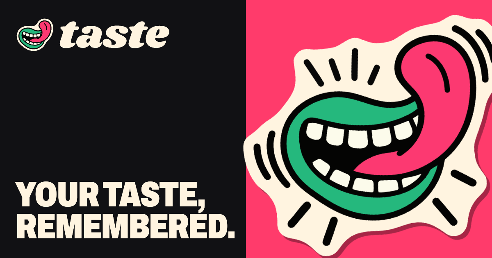

<p align="center"></p>

# Taste

An opinionated memory layer for agents.

Execution is cheap now that agents do it, so a person's judgment is the moat. Taste captures the ad hoc decisions and preferences a person brings: their words, verbatim, with provenance. It turns patterns in those words into beliefs the person ratifies, never forgets a rejection, and hands agents the right belief at the right time.

You bring the sources and the agents. Taste fetches nothing and calls no model.

> Status: v1 demo. It runs from source; [Try v1](#try-v1) below. The design map lives in [`docs/brainstorms/2026-10-19-taste/map.md`](docs/brainstorms/2026-10-19-taste/map.md).

## Core ideas

- **Memories are human words, verbatim.** Each memory is a snapshot of who said what, when, and where, with a frozen excerpt of the surrounding context. It stays understandable after the source is edited or deleted. An edit to the source becomes a new memory that `revises` the old one. Agents' words are never memories.
- **Beliefs are proposals a human ratified.** Agents propose; a human accepts or rejects in batches. An accepted belief never changes on its own. New evidence raises a new proposal that `supersedes` the old one.
- **Rejections are first-class.** "This actually isn't something we believe" is kept and read back: when an agent proposes the same idea again, and whenever a recall matches it.
- **Taste is the only home for beliefs.** Beliefs are never baked into CLAUDE.md, wiki pages or other projects, where a copy would go stale. Agents get them through recall or injection.
- **Store only what a human reviews; compute everything else on read.** There are no topics, oracles, decay scores or self-rebuilding summaries.
- **The model is enforced; the mechanics are guidance.** Invariants (verbatim, attributed, append-only, human-ratified) can't be configured. Thresholds, cadences and counts are defaults you change.

## Shape

- **Storage: append-only markdown files with YAML frontmatter.** Every memory, belief revision, decision and review thread is its own file, and no file is ever edited. Layout is by kind, then month: `memories/YYYY/MM/`, `beliefs/…`, `decisions/…`, `threads/…`. A SQLite index in `.index/` is a rebuildable cache: delete it any time. The folder can live in git, Dropbox or an Obsidian vault, and it's auditable without Taste running.
- **Links only point back in time.** A belief cites memories, a decision targets a belief, a revision supersedes an older one. Reverse lookups go through the index (or grep).
- **Interface: CLI first, MCP as a thin layer.** Writes go through `taste`; reads may also go straight to the files.
- **The core is model-free.** Distillation runs as a shipped skill inside *your* agents, on your schedule. `taste propose` checks every new proposal against existing beliefs, rejected ones included, and refuses a near-repeat unless the agent re-proposes with `--despite <belief> --why "…"`.
- **Review: a local web UI.** `taste review` serves grouped, budget-sized batches with keyboard triage, inline quotes and earlier rejections, and comment threads with an agent. An agent attaches with `taste review listen`, a long-lived process that wakes it whenever you reply.
- **Retrieval: pull by default.** `taste recall "<query>"` returns accepted beliefs first, then rejections marked "not believed", then raw memories. A narrow `UserPromptSubmit` hook for Claude Code (a few items, labelled as evidence) is opt-in at install.
- **Packaging.** Standalone binaries built with Bun; no runtime needed. An optional `taste daemon` hosts the scheduler and the review UI. There's no hosted service.

## Try v1

The v1 demo build runs from source with [Bun](https://bun.sh); there's no compiled binary yet.

```bash
bun install
alias taste="bun $PWD/src/cli/main.ts"
export TASTE_STORE=/tmp/taste-demo
taste seed                        # fictional store: Dana (demo), projects acme-web and billing-api
taste recall "tailwind"           # believed, not believed, memories
taste review                      # review UI on http://localhost:4747
```

Run `taste --help`, or `taste <command> --help`, for every command. Every command takes `--json` and `--store <dir>`. Exit codes are 0 for success, 2 for invalid input and 3 for a refused near repeat.

### Install the agent skill

`skills/taste/SKILL.md` teaches an agent when to capture, propose, recall and listen. For Claude Code, link it into your skills folder:

```bash
ln -s "$PWD/skills/taste" ~/.claude/skills/taste
```

### Install the prompt hook (opt-in)

`hooks/user-prompt-submit.ts` adds at most three ratified beliefs or rejections to each prompt, labelled as evidence. It never adds raw memories. It has a 650ms deadline and prints nothing when it runs out of time, finds no match, or finds no store. Add it to `~/.claude/settings.json` (or a project's `.claude/settings.json`):

```json
{
  "hooks": {
    "UserPromptSubmit": [
      { "hooks": [{ "type": "command", "command": "bun /absolute/path/to/taste/hooks/user-prompt-submit.ts" }] }
    ]
  }
}
```

The store is `TASTE_STORE`, otherwise `.taste` in the session's working directory. Set `TASTE_SCOPE=<project>` to recall only beliefs in that scope; without it, beliefs from every scope are eligible, each labelled with its scope. To see exactly what it would inject for a prompt, run `taste hook preview "<prompt>"`, or use the recall inspector in the review UI.

## Out of scope

Fetching or ingesting sources, agent-authored memories, summarised memories, beliefs that change themselves, topics and oracles, decay ranking, and writing beliefs into other files.

## Prior art

Karpathy's LLM wiki, Matt Pocock's personal wiki, Yak's memory and builder packages, basic-memory (files as truth), Graphiti (two timelines), Letta (a commit per edit), the [Open Knowledge Format](https://github.com/GoogleCloudPlatform/open-knowledge-format) (records are OKF-conformant through `type` and actor ids), and the Agent Memory Atlas's "rejected-value tombstone".
